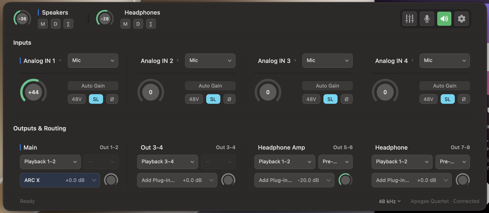

# Quartet Buddy 🎛

A menubar companion for the **Apogee Quartet** audio interface, built by
reverse-engineering Apogee Control 2's IPC protocol
([`docs/protocol-notes.md`](docs/protocol-notes.md)).

It fixes what Apogee Control 2 breaks on modern macOS: the Quartet's driver
never lets macOS's volume keys touch the **real fader** — all the system sees
is a display-only volume slider (range −64…0 dB, no audible effect), so the
volume keys are effectively dead. Quartet Buddy **binds that slider to the
real fader, both directions**, giving the Quartet a fully native macOS
volume experience — plus a few things Apogee never offered. It talks to the
ApogeeGlue daemon directly, so you keep Apogee Control 2 installed (for
routing) and everything stays in sync.

## Screenshots

**Quartet Control** — one window for everything: inputs (level mode, preamp
gain, 48V, soft limit) → outputs & routing (source, plug-in insert, trim) →
the persistent monitor bar (Speakers · Headphones with their M/D/∑ chips),
plus the live sample-rate readout — and clicking the menubar Apogee logo
toggles it.



## Features

| Feature | Details |
|---|---|
| **Native volume keys** | F11/F12 (and the volume HUD, ⌥-fine steps — everything) behave exactly like any Mac: they drive the macOS volume slider, which is **bound to the Quartet's real analog fader**. Key presses move the fader; fader moves (Apogee Control 2, the touchscreen) move the slider — always in sync, both directions. |
| **macOS slider binding** | The slider macOS shows for the Quartet is a pure display (verified: writing it changes no audio) — Quartet Buddy is the bridge that makes it real. Drag it in System Settings → Sound / Control Center and the Quartet follows; 100% ⇔ 0 dB, 0% ⇔ −64 dB. |
| **Native mute key** | F10 (and the Control Center mute icon) toggle the selected output's hardware mute. One-way by necessity: writing the OS mute control wedges the Apogee driver, so mutes done in Apogee Control 2 / on the touchscreen don't update the macOS mute display. |
| **Volume target** | Choose **Main Out** or **Headphones** for the binding — a **system-wide switch hotkey** (recorded in Settings ▸ Shortcuts) or the next/previous-output shortcuts. The menubar icon shows which one is active (Apogee logo = Main Out, headphones glyph = HP). **Defaults to Main Out** on every launch and Quartet (re)connect. |
| **Talkback hotkey** | Any ⌘/⌥/⌃-combo, recorded in-app. |
| **Talkback MIDI button** | Press a note/CC on the keyboard plugged into the Quartet's MIDI port — MIDI-learn captures it. Toggle or momentary mode. |
| **Live status** | The menubar tooltip and the Quartet Control window show both output levels in dB, mute, and talkback state — synced in real time with the hardware touchscreen, Apogee Control 2, and the app. |
| **AU insert** | Run any AU plugin independently on each of the Quartet's 4 stereo pairs, with per-pair routing (own playback / mirror another pair with a selectable tap point on its chain — Pre-FX / Post-FX / Post-Trim / silence) in the Quartet Control window. No loopback driver, no default-device switch, volume keys unaffected. See [`docs/au-insert.md`](docs/au-insert.md`). |
| **Quartet Control** | One unified audio-control window (the old "Quartet Console" + "Outputs & Plug-ins" merged) with an explicit signal flow: **inputs → outputs & routing → monitor**. Per analog input — analog level (Mic / +4 dBu / −10 dBV / Instrument), preamp gain (mic and instrument keep their own values — the slider edits the active mode's; hidden at the line levels), signal meter, +48V (Mic only), soft limit, polarity, and **ganging** (a chain-link toggle on each channel-pair's divider — inputs 1–2 and 3–4; linked preamps move together, mirrored by the app exactly like the touchscreen's linked faders). Per stereo output pair — destination name, source (a grouped menu whose second section picks where the signal is taken from a mirrored source's chain: Pre-FX / Post-FX / Post-Trim), processing slot (enable / open / replace), output trim. A persistent bottom strip keeps Main Speakers + Headphones monitor level, mute, dim, mono always visible while the rest scrolls, and the window's subtitle shows the device's name. Reads are always live (tree poll); **write ids are computed from the device serial via the cracked descriptor hash** (see [`docs/protocol-notes.md`](docs/protocol-notes.md)) — every control works on any Quartet, no setup, no capture. |
| **ADAT inputs** | An **Analog 1–4 \| ADAT 1–8** bank selector in the Inputs section header. The ADAT bank shows the optical inputs as eight compact channel strips (4 × 2) — channel heading with its **Assist…/Stop/Recheck** button on one row, then the SAME live meter the analog strips use (4-pt track, zones, held-peak marker, clip lamp) with the inline held-peak readout ("−12.4", one decimal, colored by the held value's band) at its right end. No circular readout, no gain knob, no 48V button: the Quartet's ADAT preamps are the external converter's, and the interface doesn't imply hardware control it doesn't have. The channel count follows the LIVE stream configuration (at 88.2/96 kHz each lightpipe carries four channels); off-stream channels read "—". Names are app-side (Settings ▸ Quartet ▸ Channel Names ▸ ADAT Inputs). |
| **ADAT Gain Assistant** | Assisted Gain for ADAT 1–8 — measurement and guidance, not automatic gain control, inline on each channel strip. It measures the selected channels' highest SAMPLE peak for the Settings-defined duration (default 5 s), compares it with the target (default −12 dBFS, ±2 dB) and shows a relative instruction — "↑ Increase external gain by 8 dB" — which stays FROZEN while the user turns the external preamp's knob; **Recheck** runs a fresh measurement and verifies. The loop: Listen → Recommend → Manual adjustment → Recheck → Verified. The button follows the session state (Assist… → Stop while listening → Recheck when frozen); the two-line guidance appears ONLY on the strip hosting the session — "Play your loudest section" / "Listening · 3 s" while measuring, a **trailing Done** text action when frozen (never glued to the instruction's tail) — and collapses on Done; the idle strips carry no reserved space, the row grows just the two lines while the session runs, and the window re-fits once per open/close. A take without usable signal reads "No signal during measurement" (signal arriving later still shows on the active meter), a clipped take "Input clipped" without an exact correction off the ceiling. One assistant runs at a time; it never changes the audio signal, and it cedes the device's IOProc when an analog Auto Gain calibration runs. |
| **Names** | Settings ▸ Names renames the hardware inputs (what the touchscreen and Apogee Control 2 show), the hardware outputs (Main Out / Headphones / Analog Out 1–6), and the app-side stereo-pair display names. |
| **Line out levels** | Settings ▸ Audio ▸ Line Out Levels gives each of the six ¼" line outputs (Analog Out 1–6) its own hardware reference level (+4 dBu / −10 dBV), the same knob the touchscreen's output settings drive. |
| **Talkback source** | Settings ▸ Talkback picks which input device the talkback helper listens to (Quartet inputs, MacBook mic, a Continuity iPhone mic — whatever is in the tree) and its input channel; talkback then works even when the Mac's default input isn't the Quartet. |
| **Touchscreen prefs** | Settings ▸ General drives the unit's front-panel touchscreen preferences: meter peak hold, over/clip hold, and lock home screen — verified to reach the hardware. |
| **Front-panel pads** | Settings ▸ General ▸ Front Panel Pads remaps the unit's A / B / C touchpads and the encoder push (Mute / Dim / Sum to Mono / Toggle / Clear Meters / Speaker Set engages) — the assignments the touchscreen and Apogee Control 2 show, written through ApogeeGlue (verified live). The encoder gets its own restricted menu, exactly like Apogee Control 2's. |
| **Device buffer** | Settings ▸ Audio sets the Quartet's CoreAudio IO buffer (32…4096 frames) — the tree's `preferredBufferSize` is a daemon preference that never reaches the HAL (verified), so this writes the device property directly like the sample-rate selector. |
| **Connection awareness** | The menubar icon greys out when the Quartet isn't connected (USB-level detection, instant plug/unplug), and the Quartet Control window flags what's unreachable ("Quartet Not Connected" / "Glue Offline"). |
| **Quick-control panel** | An optional floating, titlebar-free strip with the essentials — monitor knobs with their M/D/∑ chips, talkback and mute-all tiles — toggled by a configurable global hotkey (default ⌥C). Clicking the menubar Apogee logo toggles the full Quartet Control window; ⌘P pins/unpins it while it's focused. All keyboard shortcuts are configurable in Settings ▸ Shortcuts. |

No media keys are ever intercepted — macOS handles the volume keys and F10
natively, on whatever device is the current output (your MacBook speakers
keep behaving normally). The Quartet's binding applies to its own macOS
controls, and the app needs **no permissions at all** — no Input Monitoring,
no prompts.

## Requirements

- macOS 13+ (developed on macOS 27)
- Apogee Control 2 installed (its ApogeeGlue daemon is what we talk to)
- Quartet connected over USB

## Install & first run

```bash
git clone https://github.com/souf2222/quartet-buddy.git
cd quartet-buddy/QuartetBuddy
./build.sh          # builds "Quartet Buddy.app", signs, restarts the running app
```

The script relaunches the app automatically, so every rebuild goes live
immediately. The app lives in `build/Quartet Buddy.app`.

**No permissions needed.** The app never intercepts media keys and needs no
TCC grants (no Input Monitoring, no prompts, nothing to re-grant after
rebuilds). Volume keys and F10 work through macOS's own controls, bridged
to the Quartet's hardware.

> The build script signs the app with the **QuartetBuddy Developer**
> certificate (created in your keychain during setup) so the Launch-at-Login
> registration survives every rebuild; without it, it falls back to ad-hoc
> signing.

**Launch at Login** is a checkbox in Settings ▸ General. Your choice is
remembered, and if the registration ever goes missing (app moved/renamed),
the app re-registers itself automatically on the next launch.

### Setup

- **Volume target:** record a switch hotkey in Settings ▸ Shortcuts (or use
  the next/previous-output shortcuts) — what the macOS slider binding
  controls. Resets to Main Out whenever the app launches or the Quartet
  (re)connects.
- **AU insert:** Settings ▸ Plug-ins ▸ *Plug-in insert active* turns the
  insert on; routing and the processing slots live in the Quartet Control
  window's **Outputs & Routing** section.
- **New Quartet:** plug it in and the **setup wizard opens by itself**.
  Path-ids are hashed per device serial, so
  each physical Quartet needs its ids captured once: follow 5 steps (move the
  Main Out fader, the HP fader, toggle each mute, toggle dim) — the wizard
  listens to the glue stream, captures each id live and saves it to
  preferences. No code change, no Terminal needed.
- **Talkback:** *Turn Talkback On* to test, then record the *Talkback Hotkey*
  and/or *MIDI Button → Learn…* (press a button on your keyboard)
- **MIDI mode:** *Toggle* (press = on/off) or *Momentary* (hold to talk)

## How it works

```
volume + mute keys ──► macOS (native, untouched) ──► OS "Quartet" volume + mute
                                                          │  ▲
                          OS control changes ─────────────┘  │ hardware state
                          (applied to fader/mute)           │ (copied onto the
                                                           ▼  OS controls)
                              ApogeeGlue IPC  ──►  ApogeeGlue daemon ──► Quartet
                              (TCP localhost)         ▲
switch/talkback hotkey ──► RegisterEventHotKey ──────┤
MIDI keyboard ──► CoreMIDI ("Quartet" source) ────────┘
```

The OS "Quartet" volume + mute controls are display-only (the driver never
applies them to the audio), so `OSVolumeMirror` bridges them: OS control
changes are written to the real hardware through ApogeeGlue, and hardware
changes (from Apogee Control 2, the touchscreen, key presses) are copied
back onto the OS controls.

Quartet Buddy connects to ApogeeGlue like the official apps do and speaks its
protocol: JUCE framing (magic `F2B49E2C`), the custom ValueTreeSyncProtocol
records (checksum-fold codec, `setProperty` messages with 4-byte path-ids),
and the gzip'd JUCE ValueTree binary stream used for full-tree sync. All of
it is documented in [`docs/protocol-notes.md`](docs/protocol-notes.md) and
reimplemented in `QuartetBuddy/Sources/GlueProtocol.swift`. Both read and
write paths were verified against the live daemon.

## Repo layout

```
docs/protocol-notes.md       complete wire protocol spec
docs/captures/               sample tree dump from the live device
tools/                       RE toolchain (capture analyzer, probes, id watcher,
                             write tests — the scripts that cracked the protocol)
QuartetBuddy/Sources/        the Swift app
QuartetBuddy/assets/         Apogee logo
QuartetBuddy/build.sh        build + sign + bundle
```

## Troubleshooting

- **Icon is greyed out** — the Quartet isn't detected over USB. Check the
  cable/port; the icon returns to full color the moment it's seen again.
- **Volume keys do nothing on the Quartet** — the keys drive the macOS
  slider, and the app carries its level to the Quartet, so the bridge must
  be up (Apogee Control 2 / its daemon not running → the app auto-reconnects
  every 3 s). And the Quartet must be the current output device — with any
  other device selected, the keys adjust that device instead (native macOS
  behavior).
- Everything logs to `~/Library/Logs/QuartetBuddy.log` (Settings ▸ General ▸
  *Open Debug Log…*) — every slider move, mute change, and write is recorded.
- **MIDI learn finds nothing** — the keyboard must be plugged into the
  Quartet's MIDI port (CoreMIDI source named "Quartet"); it won't see USB
  keyboards connected directly to the Mac.
- **Talkback does nothing audible** — the TalkbackHelper needs a valid
  source/destination configured in Apogee Control 2's Talkback settings.

## Notes & limitations

- Path-ids in `PathIds` are a hash of the property path **including the
  device serial** — every physical Quartet has its own table. Two units are
  captured in code (`quartet1528B15CEE547FA`, `quartet15819153CE0E077`);
  any **other** Quartet auto-opens the built-in **setup wizard**
  (*Setup New Quartet…*) — 5 guided steps, ids captured from the live glue
  stream and saved to preferences. No rebuild needed.
- An Apogee software update could change the protocol; the app shows the
  offline state and the debug log tells you where it broke. The protocol
  notes contain everything needed to re-crack it.
- This is an independent interoperability tool for your own hardware; it
  contains no Apogee code.
